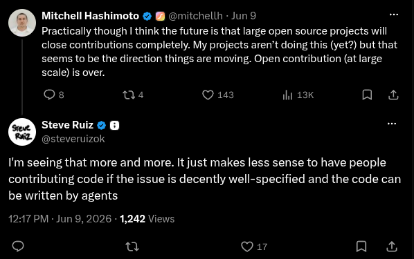

Here it is, the post that most everyone is writing some variation of right now: the basic function of my job seems to have changed, maybe permanently. Functioning code is now being produced at a rate far beyond what a human could manage, even beyond what can be reasonably reviewed by human engineers. Many are ready to accept this given the results that are now achievable (whether the short-term benefit will be sustainable in the long run is another unanswered question).

Recently I watched the following video, in which you can witness a minor(?) existential crisis:

<iframe width="560" height="315" src="https://www.youtube.com/embed/R_uf5OfMGio" title="Can AI Make a Game Engine?" frameborder="0" allow="accelerometer; clipboard-write; encrypted-media; gyroscope; picture-in-picture; web-share" referrerpolicy="strict-origin-when-cross-origin" allowfullscreen></iframe>

I know it's a cliche, but It's pretty remarkable what models are capable of now. I also find the implication pretty sad. For years I have been in the highly privileged position that the primary day-to-day mechanism of my job -- writing code -- is one that I genuinely enjoy performing. Now it's no longer feasible to be doing things "by hand".

Don't get me wrong, there's plenty about my job that I still greatly enjoy, and that's a massive privilege on its own. I still want to examine what this change means and why it can sometimes feel like a loss.

What is it about the act of (AI-free) programming that I still find so much value in?

## Accessibility

One thing I've always deeply appreciated about programming is that for most purposes the barrier to entry is quite low. Depending on what you want your program to do, you can generally get by on commodity devices that many already have available. With an active internet connection you gain access to a wealth of free learning resources, at which point you're mostly limited by how much time you can invest.

I am (almost entirely) self-taught when it comes to programming, and though I won't claim it to be a superior method, for better or worse I didn't spend a dollar on it as a hobby until just before it became a career: my first programming-related purchase was a book on algorithms I bought to study while interviewing (though I credit World of Warcraft with actually landing me my first real role -- a story for another time).

That level of accessibility has always been inspiring to me. It might take a while, but you can build *so much* from small foundations.

Needing a paid subscription from a company like Anthropic or OpenAI, being subject to token limits and provider uptime, needing to be constantly online to work; all of this contributes to a far less accessible environment, creating a barrier that will keep many from ever attempting to learn. Even if "the old ways" still exist, knowing there's a tool which trivializes something you have to struggle with early on is pretty discouraging. Even now, the cost associated can be exorbitant, and it's likely to increase once investors are no longer willing to subsidize inference in order to drive growth. Free/open models are becoming a capable alternative, but that depends on owning even more expensive (and scarce) hardware.

## Ownership

Both in a literal and figurative sense, the transition away from hand-written programs harms *ownership* over what we create and how its created.

LLMs are famously built on violations of content ownership, devouring training data from every possible source with often [dubious levels of concern](https://arstechnica.com/information-technology/2024/01/openai-says-its-impossible-to-create-useful-ai-models-without-copyrighted-material/) for license and copyright.

[This blog post](https://tailscale.com/blog/100x-more-programmers) from **tailscale** does a solid job spelling out the *sovereignty* that we risk losing by relying on a handful of monolithic providers, and how that ultimately impacts everyone.

The open source community which has enabled individuals and small groups to build so much upon one another's work has been a beacon of collective ownership and responsibility, and it's under strain. The new reality of LLM-powered development has greatly increased the volume and lowered the median quality of contributions, putting a burden on maintainers that has led to some [closing their projects to external pull requests](https://latent.space/p/pr-not-welcome/). When individuals can generate a whole team's worth of code, isn't there less incentive to welcome collaborators in the first place?

[`tldraw`](https://github.com/tldraw/tldraw#contributing) creator Steve Ruiz responding to Mitchell Hashimoto [on Twitter](https://x.com/steveruizok/status/2064381300572672450)

Developing software without writing or perhaps even reading the majority of the code reduces "ownership" as a measure of our understanding of the code itself -- knowing how it works and intuiting where problems may lie. It's possible that at some point, this will truly matter less and we will rely on our understanding of *systems.* I don't know if we're there yet.

## Enjoyment

Finally, there's perhaps the most fundamental part. I'm already doing something most wouldn't recommend if you want to "be serious," I'm [building my own game engine](/blog/shadergen-pt1/) despite conventional wisdom advising against it if you want to make a game. I'm doing it because that's the part I've found I enjoy! And by doing it the slow way, I'm retaining more of what I'm learning, kind of like retyping example code rather than copy-and-pasting.

I've heard some say that LLMs eliminate the "hassle" of coding, leaving only "the fun part" of creating something. I do agree that programming with an LLM can be a creative process -- or at least, it's not inherently devoid of creativity. And there is joy in creation! My personal belief is that, to some degree, the satisfaction gained is proportional with the effort expended in the process (of which there are many types). Prompting code generation is output-focused, which can definitely provide a different type of satisfaction. But if you're primarily measuring enjoyment based on what you're producing, it's very easy to end up on some version of the hedonic treadmill, chasing greater and greater output. If the agent is autonomous enough, why spend time managing one at a time when you can command a swarm?

Luckily, I have heard others express the opposite, sharing my sentiment that a fundamentally enjoyable part of the process is being stripped away. Knowing that others are having a similar experience doesn't make it better, but it does give me hope for the future. Maybe that's why I'm writing this now -- in case you were wondering, it's not just you.

I've accepted that to be a professional software engineer at this point in time means embracing the use of AI, regardless of my personal feelings. I've already used it, and seen it used, to do pretty amazing things that wouldn't otherwise have been feasible. But for most personal projects, I don't plan to stop hand-writing code any time soon.

But enough of that, this is time that could be spent hand-refactoring the same code I've been toying with for months. So if you'll excuse me, I must be going back to my knitting.

*Whether it was great or terrible, all of this was human-written. Thank you for reading!*
